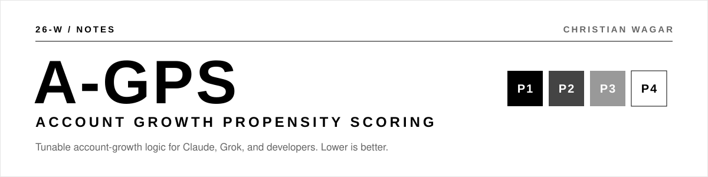

# A-GPS · Hosted MCP server

**[ ADD THIS ONE URL TO YOUR AI ]**

```
https://agps-mcp.<your-subdomain>.workers.dev/mcp     ← placeholder until it goes live
```

That's the whole setup. Once it's added, your AI can score your accounts with A-GPS. Golf rules: lower is better. Every account lands in P1 to P4, with the why and a focus-this-week list.

## Add it in 2 minutes (no code)

| App | Where to paste the URL |
| --- | --- |
| **Claude** (web or desktop) | Settings → Connectors → **Add custom connector** → paste the URL |
| **ChatGPT** | Settings → Connectors → turn on developer mode → **Create** → paste the URL |
| **Cursor** | Settings → MCP → **Add new MCP server** → type "streamable HTTP" → paste the URL |

Then attach your account spreadsheet and ask:

> "Score these with A-GPS and tell me who to focus on this week."

Want different weights? Just say so, for example *"use 25% GTM and 15% marketing"* or *"more runway before renewal is better."* The AI passes the tweak along.

## What it can do

| Tool | In plain English |
| --- | --- |
| `score_accounts` | Score my accounts and sort them into P1–P4 |
| `explain_account` | Why did this account land where it did? |
| `get_focus_list` | Who should I spend time on this week? |
| `get_default_settings` | Show me the model: weights, bands, fields |

## Read this first: it's a framework

The weights and bands were tuned for one book of business. Dial them in for yours: customer spend, deal sizes, risk appetite, sales motion, and data quality. See the [methodology](../../METHODOLOGY.md) and the [settings file](../../config/agps.v2.yaml).

## Privacy

- Nothing is stored. There's no database, no KV, no sessions. Each request is scored in memory and forgotten.
- Nothing is logged. Workers observability is off and the code never logs request bodies.
- No sign-up and no auth. Because it holds no data, there's nothing to protect behind a login.

---

## For builders

The scoring engine (`src/engine.ts`) is a line-for-line TypeScript port of the Python package in `src/agps`. Defaults load from `config/agps.v2.json` when it's built.

```bash
cd integrations/hosted-mcp
npm install
npm test             # parity tests: TypeScript must match Python exactly
npm run dev          # local server at http://127.0.0.1:8787  (MCP at /mcp, landing page at /)
npm run smoke        # in another terminal: real MCP client lists tools and scores sample data
```

If you change the Python engine or the config, run `npm run fixtures` (it needs python3) and then `npm test`.

### Deploy (Cloudflare Workers, free tier)

```bash
npx wrangler login     # opens a browser to sign in to your Cloudflare account
npm run deploy         # prints https://agps-mcp.<your-subdomain>.workers.dev
npm run smoke -- https://agps-mcp.<your-subdomain>.workers.dev/mcp
```

Optional custom domain (for example `mcp.26-w.com`) if the domain is on the same Cloudflare account: uncomment the `routes` line in `wrangler.jsonc` and deploy again. Then add `allowedHostnames: ["mcp.26-w.com"]` to `createMcpHandler` in `src/index.ts`.

Endpoints: `/` landing page · `/mcp` Streamable HTTP MCP (stateless) · `/health`.

Built by [Christian Wagar · 26-W](https://26-w.com) · [Read the writeup](https://26-w.com/notes/account-growth-propensity/) · MIT License
